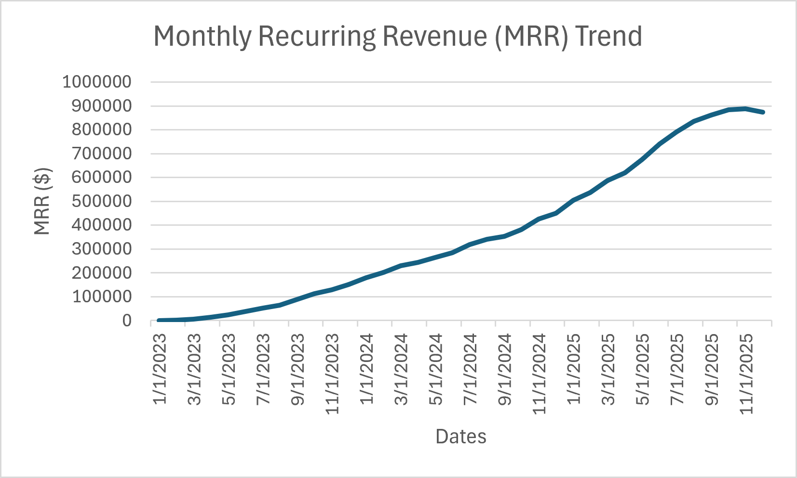
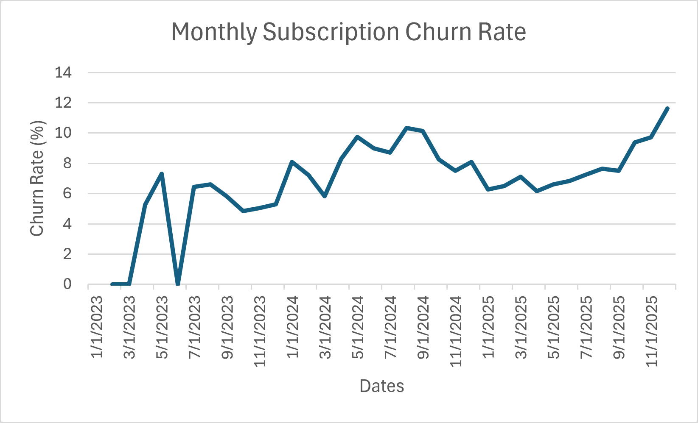
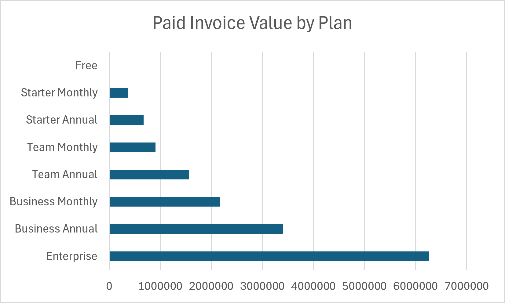
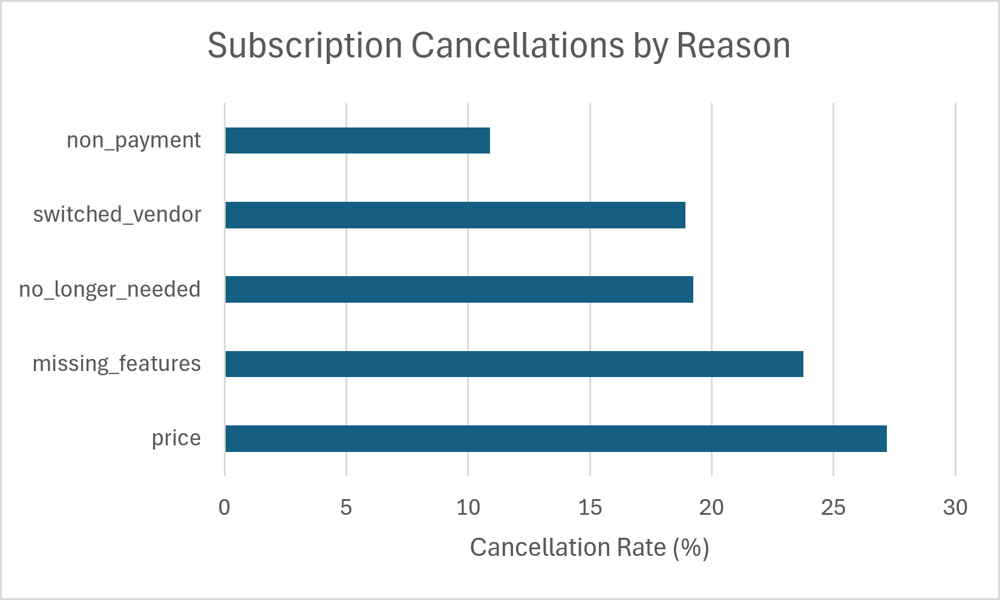
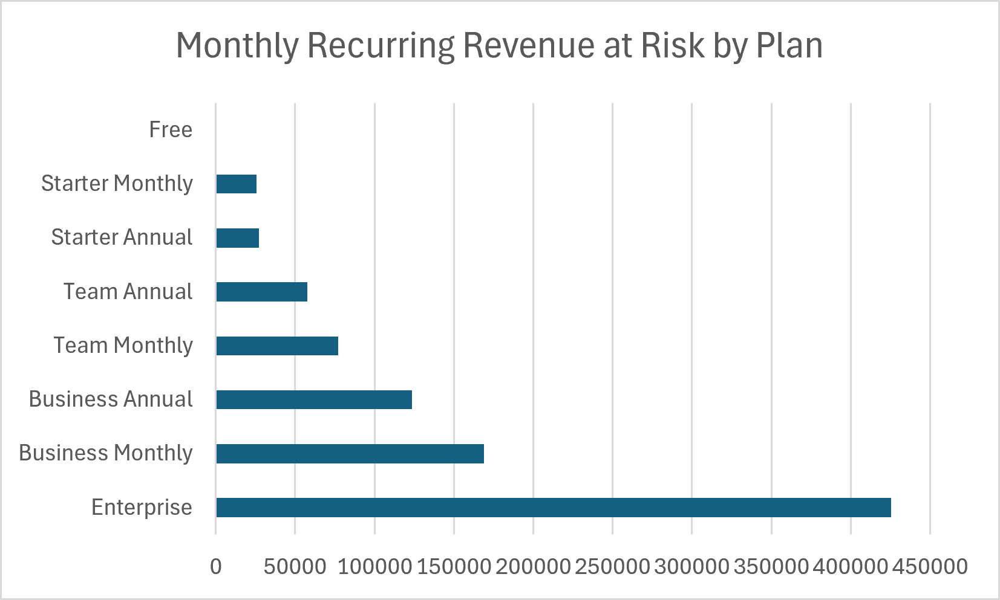
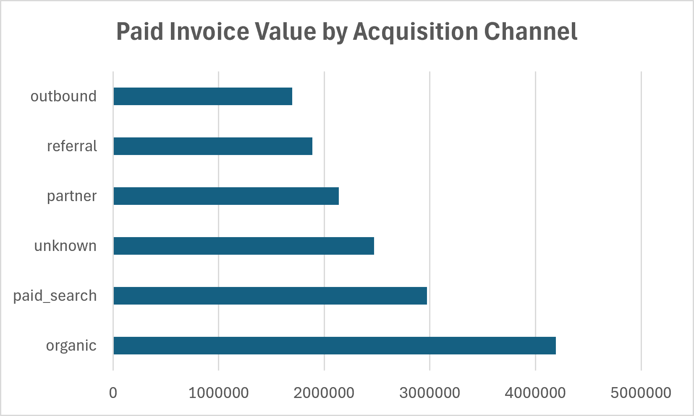
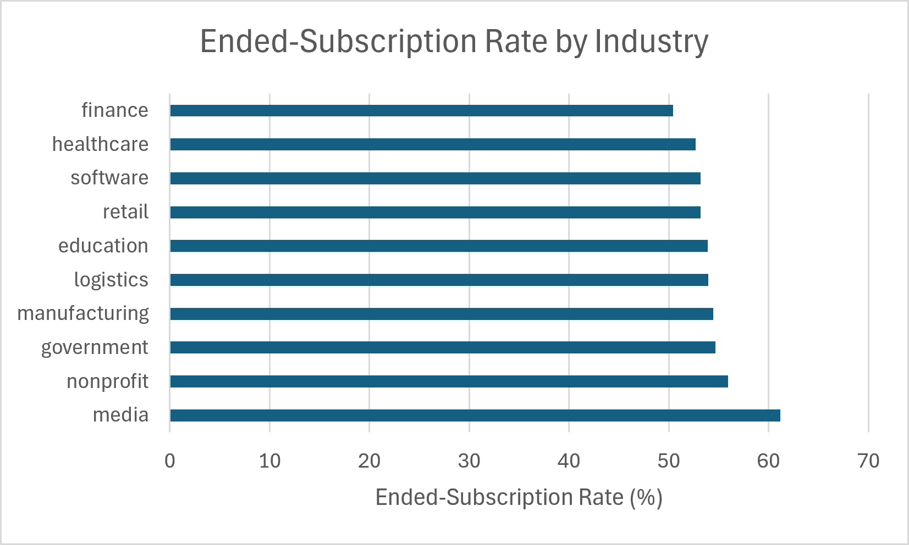
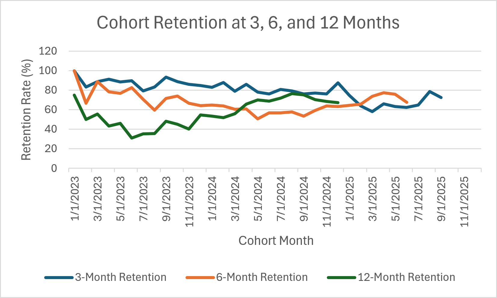

# SaaS Customer Churn & Revenue Analysis

## Project Overview

This project analyzes a B2B SaaS company's customer, subscription, billing, and product usage data.

The main business question is:

**How can a SaaS company grow recurring revenue while reducing customer churn?**

I used PostgreSQL to study revenue, subscription plans, customer cancellations, churn, retention, payment problems, acquisition channels, and product usage.

The project also includes advanced SaaS analysis such as Monthly Recurring Revenue (MRR), Annual Recurring Revenue (ARR), cohort retention, subscription lifetime, revenue at risk, and high-value churn segments.

For time-based subscription analysis, I used **December 31, 2025** as the analysis cutoff. Subscription records starting after this date were not included in churn and retention calculations.

---

## Business Questions

This project answers the following business questions:

1. Which subscription plans generate the most paid invoice value?
2. Which industries, countries, and company sizes generate the most revenue?
3. Which acquisition channels bring the most valuable customers?
4. Which plans have the highest payment failure risk?
5. What are the main reasons customers cancel their subscriptions?
6. Which customer segments have the highest ended-subscription rates?
7. How is Monthly Recurring Revenue (MRR) changing over time?
8. How is monthly subscription churn changing over time?
9. How well are customer cohorts retained after 3, 6, and 12 months?
10. Which plans have the highest recurring revenue at risk?
11. Which customer segments have the highest-value churn?
12. How does product usage compare between active and ended customers?

---

## Dataset

The project uses a B2B SaaS subscription dataset with six main tables:

- `plans` – subscription plans, pricing, tiers, and billing type
- `organizations` – company information such as industry, country, company size, and acquisition channel
- `users` – users connected to each organization
- `subscriptions` – subscription history, plan, seats, start date, end date, and cancellation reason
- `invoices` – billing records, payment status, invoice amount, and payment dates
- `usage_events` – product activities such as reports, dashboard views, exports, API calls, and integrations

The raw dataset contains:

- 3,000 organizations
- 26,000 users
- 4,200 subscriptions
- 46,000 invoices
- 180,000 usage events
- 8 subscription plans

---

## Tools Used

- **PostgreSQL** – used to store and analyze the data
- **DBeaver** – used to run SQL queries and export results
- **Python** – used to convert Parquet files into CSV files
- **DuckDB** – used during the Parquet-to-CSV conversion
- **Excel** – used to create charts and visualizations
- **VS Code** – used to organize SQL, documentation, and project files
- **GitHub** – used for version control and publishing the project

---

## Data Quality Checks

Before starting the main analysis, I checked the dataset for common data quality problems.

The checks included:

- Duplicate primary keys
- Missing required values
- Invalid dates
- Invalid numeric values
- Foreign key problems
- Blank text values
- Duplicate business records
- Subscription and cancellation consistency
- Duplicate invoice records
- Payment status and payment date consistency
- Usage events before organization signup or user join dates

Several important issues were found.

There were subscription records with invalid date relationships, repeated invoice records, and usage events that happened before valid organization or user dates.

I also found **181 subscriptions starting after the December 31, 2025 analysis cutoff**. These records were excluded from time-based churn and retention analysis.

I kept the raw data unchanged and handled these problems inside the SQL queries.

For the final analysis:

- Invalid subscription date records were excluded when needed
- Subscription records after the analysis cutoff were excluded from churn and retention calculations
- Exact duplicate invoices were excluded from revenue analysis
- Repeated billing periods were handled carefully to avoid overstating revenue
- Invalid usage events were excluded from time-based product usage analysis

---

## Key Findings

- Monthly Recurring Revenue grew from about **$237 in January 2023** to a peak of about **$887,800 in November 2025**.

- MRR decreased slightly to about **$874,305 in December 2025**.

- Monthly subscription churn increased near the end of 2025 and reached **11.63% in December 2025**.

- Enterprise was the highest-value plan, producing about **$6.27 million** in paid invoice value.

- Business Annual was the second highest plan with about **$3.41 million** in paid invoice value.

- Price was the biggest cancellation reason at **27.18%**.

- Missing features was the second biggest cancellation reason at **23.77%**.

- Enterprise had the highest monthly recurring revenue at risk from ended subscriptions at about **$425,456**.

- Organic was the strongest acquisition channel, producing about **$4.19 million** in paid invoice value.

- Partner customers had a strong average paid value of about **$6,513.68 per organization**.

- Media had the highest ended-subscription rate at **61.18%**.

- Nonprofit had the second highest ended-subscription rate at **55.92%**.

- Payment failure rates were relatively low compared with overall customer churn.

- Cohort retention was different between customer signup groups, showing that some groups stayed longer than others.

---

## Business Recommendations

- Focus more on keeping Enterprise and Business customers because they bring a large amount of revenue.

- Create stronger customer success programs for high-value accounts before they decide to cancel.

- Review pricing because price was the biggest cancellation reason.

- Improve important product features because missing features was the second biggest reason customers canceled.

- Watch monthly churn closely because churn increased strongly near the end of 2025.

- Give more attention to industries with high churn, especially media and nonprofit customers.

- Continue investing in organic acquisition because it produced the highest paid invoice value.

- Study partner acquisition more closely because partner customers had a high average paid value.

- Use subscription history, customer usage, plan type, and cancellation information together to identify customers who may be at risk.

- Improve customer onboarding and support so customers understand the product and its value earlier.

- Build a churn-risk model in the future to help the company contact high-risk customers before they cancel.

---

## Visualizations

### 1. Monthly Recurring Revenue (MRR) Trend



MRR grew strongly from 2023 through most of 2025. It reached its highest level in November 2025 before decreasing slightly in December.

---

### 2. Monthly Subscription Churn Rate



Monthly churn increased near the end of 2025 and reached **11.63% in December 2025**.

This is an important warning because increasing churn can slow recurring revenue growth.

---

### 3. Paid Invoice Value by Plan



Enterprise produced the highest paid invoice value at about **$6.27 million**, followed by Business Annual at about **$3.41 million**.

This shows that higher-value plans are very important to the company's revenue.

---

### 4. Subscription Cancellations by Reason



Price was the largest cancellation reason at **27.18%**, followed by missing features at **23.77%**.

This shows that both pricing and product value are important retention problems.

---

### 5. Monthly Recurring Revenue at Risk by Plan



Enterprise had the highest monthly recurring revenue at risk from ended subscriptions at about **$425,456**.

Because Enterprise customers are high-value customers, losing these accounts can have a large effect on recurring revenue.

---

### 6. Paid Invoice Value by Acquisition Channel



Organic was the strongest acquisition channel with about **$4.19 million** in paid invoice value.

Paid search was second with about **$2.97 million**.

---

### 7. Ended-Subscription Rate by Industry



Media had the highest ended-subscription rate at **61.18%**.

Nonprofit was second at **55.92%**, while finance had the lowest rate among the industries analyzed at **50.45%**.

---

### 8. Cohort Retention



The cohort analysis compares customer retention after **3, 6, and 12 months**.

Later cohorts do not have values for longer retention periods when they have not had enough time to reach those milestones.

The analysis uses **December 31, 2025** as the final cutoff, so post-cutoff subscriptions are not included.

---

## Advanced Analysis

### Monthly Recurring Revenue

MRR increased strongly over the analysis period and reached a peak of approximately **$887,800 in November 2025**.

By December 2025, MRR was approximately **$874,305**.

---

### Annual Recurring Revenue

ARR was calculated using:

`ARR = MRR × 12`

At the November 2025 MRR peak, estimated ARR reached approximately **$10.65 million**.

---

### Monthly Churn

Monthly churn changed throughout the analysis period.

Near the end of 2025:

- October 2025: **9.38%**
- November 2025: **9.73%**
- December 2025: **11.63%**

The increase shows that customer retention became a bigger problem near the end of 2025.

---

### Cancellation Reasons

The corrected cancellation results were:

- Price: **27.18%**
- Missing features: **23.77%**
- No longer needed: **19.24%**
- Switched vendor: **18.92%**
- Non-payment: **10.89%**

Price and missing features together represent the two largest reasons customers canceled.

---

### Revenue at Risk

The highest monthly recurring revenue at risk was:

- Enterprise: **$425,456**
- Business Monthly: **$169,071**
- Business Annual: **$123,590**

This shows why keeping high-value customers is important.

---

### Industry Retention Risk

The highest ended-subscription rates were:

- Media: **61.18%**
- Nonprofit: **55.92%**
- Government: **54.65%**
- Manufacturing: **54.45%**
- Logistics: **53.96%**

Finance had the lowest ended-subscription rate among the industries analyzed at **50.45%**.

---

### Product Usage and Retention

Organizations with only ended subscriptions had about **18.44 average valid usage events**, while active organizations had about **17.33**.

Ended-only organizations also had about **76.64 average usage quantity**, compared with about **72.09** for active organizations.

This does not mean that higher usage causes churn.

Ended customers may have had more time to use the product before cancellation. Product usage should be studied together with customer lifetime, pricing, plan type, and cancellation reasons.

---

## Project Structure

```text
saas_customer_churn_project/
├── data/
│   ├── plans.parquet
│   ├── organizations.parquet
│   ├── users.parquet
│   ├── subscriptions.parquet
│   ├── invoices.parquet
│   └── usage_events.parquet
│
├── sql/
│   ├── 01_data_setup.sql
│   ├── 02_data_quality.sql
│   ├── 03_exploratory_analysis.sql
│   ├── 04_business_analysis.sql
│   └── 05_advanced_retention_analysis.sql
│
├── visuals/
│   ├── monthly_mrr_trend.csv
│   ├── monthly_mrr_trend.png
│   ├── monthly_churn_rate.csv
│   ├── monthly_churn_rate.png
│   ├── paid_invoice_value_by_plan.csv
│   ├── paid_invoice_value_by_plan.png
│   ├── cancellation_reasons.csv
│   ├── cancellation_reasons.png
│   ├── revenue_at_risk_by_plan.csv
│   ├── revenue_at_risk_by_plan.png
│   ├── paid_value_by_acquisition_channel.csv
│   ├── paid_value_by_acquisition_channel.png
│   ├── ended_rate_by_industry.csv
│   ├── ended_rate_by_industry.png
│   ├── cohort_retention.csv
│   └── cohort_retention.png
│
├── docs/
│   ├── saas_subscriptions.schema.sql
│   └── 05_business_insights.md
│
├── scripts/
│   └── convert_parquet_to_csv.py
│
├── .gitignore
├── .gitattributes
└── README.md
```

---

## Conclusion

This project helped me understand how a SaaS company can use data to improve revenue and reduce customer churn.

The company showed strong recurring revenue growth, but churn increased near the end of 2025. Enterprise and Business plans were important because they produced a large amount of revenue.

Price and missing features were the two biggest cancellation reasons. Media customers also had a much higher ended-subscription rate than other industries.

The main business opportunity is to protect high-value customers, improve product value, understand why customers leave, and identify churn risk earlier.

This project helped me practice PostgreSQL, data cleaning, business analysis, revenue analysis, churn analysis, cohort retention, SaaS metrics, data visualization, and GitHub project documentation.